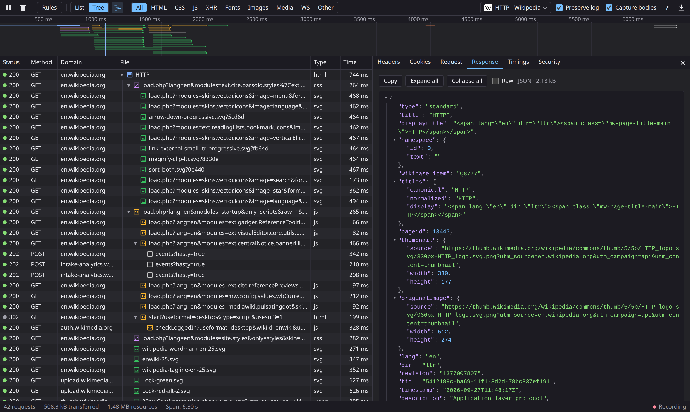

# netmon — Always-On Network Monitor

A browser extension for Firefox and Chrome that records network traffic in the background, all the time, and shows it in a DevTools-style network panel in its own window. No need to open DevTools before the request happens.



## Features

- Records every tab continuously; view one tab, the current tab or all tabs, with tabs grouped by window and closed tabs kept under their last title
- Overview timeline above the list (like Chrome's): bars colored by request type, DOMContentLoaded/Load markers, drag to filter by time range
- Request/response headers, bodies (collapsible JSON tree with right-click copy of key, value or path, syntax highlighting), cookies, timings
- TLS / security details per request
- WebSocket traffic, including sending and editing-and-resending messages; HAR export includes WebSocket frames
- Resend / edit and resend requests
- Copy as cURL, fetch, Python `requests` and Python `curl_cffi`
- DevTools-compatible filter language (`-mime-type:`, `transferred-larger-than:`, `is:blocked`, `size-larger-than:` …) in a rules editor (Ctrl+F)
- Shows which extension blocked a request (e.g. "Blocked by uBlock Origin")
- Initiator tree view (which script/stylesheet loaded what)
- Offline preview of HTML (using already-recorded resources), images, SVGs and fonts
- URL blocking

## Keyboard

| Keys | Action |
|---|---|
| ↑ ↓, Page Up/Down, Home/End | Move through the requests |
| Ctrl+↑ / Ctrl+↓ | The request that started this one / the next request one level higher |
| Enter / Space | Open or close the request's details |
| Tab / Shift+Tab, Shift+→ / Shift+← | Next / previous details tab |
| Shift+↑ ↓, Shift+Page Up/Down | Scroll the details |
| Ctrl+R / F5 (Shift for a hard reload) | Reload the inspected tab |
| Ctrl+F | Filter rules |
| Esc | Close the details |
| ? | All shortcuts (also the ? button) |

## Build

```sh
./build.sh
```

Produces:

- `always-on-netmon.xpi` — Firefox (Manifest V2)
- `dist/chrome/` and `always-on-netmon-chrome.zip` — Chrome (Manifest V3)

`./build.sh --install` also hands the new `.xpi` to your running Firefox, which updates the installed add-on in place (set `FIREFOX=/path/to/firefox` if it picks the wrong one).

## Install

**Firefox:** `about:addons` → gear icon → *Install Add-on From File…* → `always-on-netmon.xpi` (unsigned builds need Firefox Developer Edition/Nightly with `xpinstall.signatures.required` set to `false`, or load it temporarily via `about:debugging`).

**Chrome:** `chrome://extensions` → enable *Developer mode* → *Load unpacked* → `dist/chrome`.

In Chrome, response bodies, TLS details and initiators come from the `chrome.debugger` API, so Chrome shows a "started debugging this browser" bar while *Capture bodies* is on.

## Optional: toolbar-free window in Firefox

`userChrome-netmon.css` hides Firefox's toolbars in the monitor window. Copy it into your profile's `chrome/userChrome.css` and set `toolkit.legacyUserProfileCustomizations.stylesheets` to `true`.

## Credits

Request type icons are from Chromium DevTools (BSD license, see `LICENSE-chromium-devtools.txt`).
